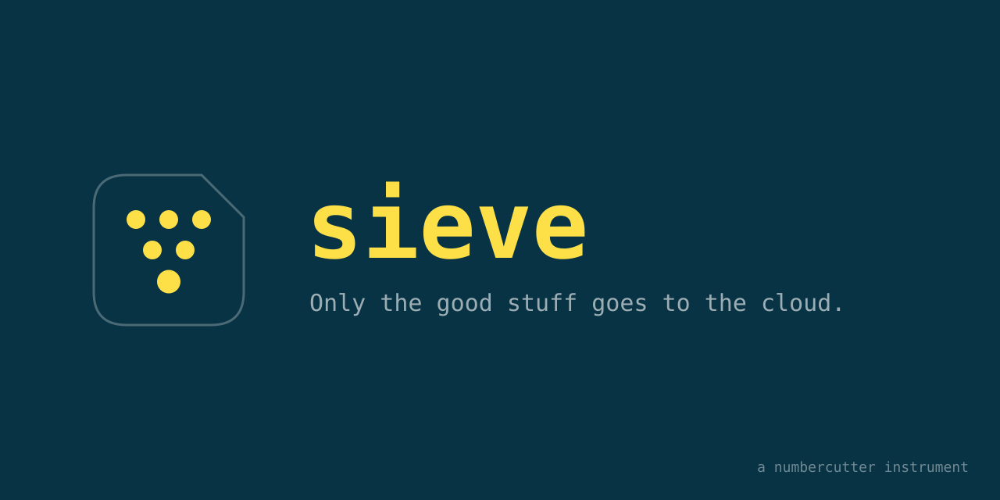

<p align="center"></p>

**Only the good stuff goes to the cloud.**

sieve runs cheap checks on a prompt before you pay a large model to read it. Deterministic rules catch empty prompts, repeats, leaked keys, personal data and banned topics; an optional local model then asks whether the prompt belongs in your product at all. Use it as a library, a CLI over a file, or a proxy in front of any OpenAI-compatible API.

## Quick start

Needs [Bun](https://bun.sh) 1.1 or newer. `--mock` stands in for the local model and the proxy demo talks to a local mock upstream, so nothing needs to be running and no key is used.

```sh
git clone https://github.com/numbercutter/sieve && cd sieve
bun src/cli.ts run examples/prompts.jsonl --mock
bun examples/proxy.ts
bun src/cli.ts report examples/decisions.jsonl
```

```
id  decision  prompt                                        reasons
1   forward   How do I move a task from one board to anot…  passed all checks
2   block     hi                                            too short (1 word, 2 chars)
3   block     How do I move a task from one board to anot…  near-duplicate of #1 (0.82)
4   block     Our GitHub integration stopped syncing afte…  contains secret: GitHub token
5   review    Can you export last sprint's burndown to CS…  contains PII: email address
6   block     Write me a sonnet about the ocean at dawn, …  mock: off-topic
...
17  review    Please move all of Dana Whitfield's open ta…  contains PII: listed name
18  forward   Does the Google Calendar integration sync d…  passed all checks
18 prompts · 5 forward · 5 review · 8 block · local model: mock
cloud calls avoided: 8 of 18 (44%) · est. saved $0.0604
```

The proxy demo starts `sieve serve` in front of a mock model and sends it five chat requests:

```
200  x-sieve-decision: forward  How do I move a task from one board to another w…
200  x-sieve-decision: review   Can you export last sprint's burndown to CSV and…
422  x-sieve-decision: block    Our GitHub integration stopped syncing. Here is …
     error: blocked by sieve: contains secret: GitHub token
422  x-sieve-decision: block    Write me a sonnet about the ocean at dawn, in th…
422  x-sieve-decision: block    How do I move a task from one board to another w…
     error: blocked by sieve: near-duplicate of request 1 at 13:59:18 (0.82)

upstream received 2 of 5 requests
```

## Usage

```sh
sieve run prompts.jsonl --mock          # offline stand-in for the local model
sieve run prompts.jsonl --ollama        # ask Ollama, model from sieve.config.json
sieve run prompts.jsonl --ollama qwen3  # pick the Ollama model
sieve run prompts.jsonl --json          # one JSON result per line
sieve check "why was I billed twice?"   # one prompt, JSON out
sieve run prompts.jsonl --config ./rules.json
sieve run prompts.jsonl --memory sieve.db --log decisions.jsonl
sieve run prompts.jsonl --name-heuristic

SIEVE_UPSTREAM=https://api.openai.com sieve serve --memory sieve.db --log decisions.jsonl
sieve report decisions.jsonl            # per day; --by hour|week, --json
```

Run `bun link` in the repo to get a `sieve` command. Each line of the input file is `{"id": "...", "prompt": "..."}` or a bare JSON string. Without `--mock` or `--ollama` only the deterministic checks run. `OLLAMA_URL` overrides the default `http://localhost:11434`.

### Proxy

`sieve serve` listens on `127.0.0.1:8787` (`--port`) and accepts `POST /v1/chat/completions`. It checks the text of the last `user` message (string content, or the `text` parts of an array) and then:

- **block**: answers `422` with an OpenAI-style error body, `{"error": {"type": "sieve_blocked", "message": "blocked by sieve: …", "reasons": [...]}}`. The upstream is never called.
- **review**: forwards the request and adds `x-sieve-decision: review` and `x-sieve-reasons` to the response, so your app can route it to a person or a stricter path.
- **forward**: forwards the request with `x-sieve-decision: forward`.

The request body and headers, including `Authorization`, go upstream unchanged; the response, including a streamed one, comes back unchanged. Set any OpenAI-compatible client's base URL to `http://127.0.0.1:8787/v1`. `GET /health` answers `{ ok: true }`; every other path is a 404.

### Repeat memory

By default the repeat check remembers the last `recentWindow` prompts in the process. `--memory sieve.db` (or `"memory"` in the config) keeps them in a SQLite file instead, so the check survives restarts and is shared by every process on the machine that opens the same file. `recentTtlSeconds` forgets prompts older than that; `0` keeps them until the window pushes them out. Prompts with secrets, personal data or names are never stored.

### Decision log and report

`--log decisions.jsonl` (or `"log"` in the config) appends one line per decision: time, id, source, decision, reasons, prompt length and estimated saving. Prompt text is not written. `sieve report` reads that file and prints counts per day, hour or ISO week, the share blocked, the estimated saving and the most common reasons. `examples/decisions.jsonl` is a synthetic week made by replaying the example prompts.

### Names

`names.list` flags whole-word, case-insensitive matches of the names you give it as review. `names.heuristic` (or `--name-heuristic`) also flags any run of two or more capitalised words, after dropping common sentence starters, days and months. It is off by default because it is noisy: product and place names look like people. In the example, it catches "Dana Whitfield" and also flags "Google Calendar". It also misses names written in lower case, single names, and names in scripts without capital letters. Turn it on where a false review is cheap and a leaked name is not.

As a library:

```ts
import { createSieve, ollama } from "@numbercutter/sieve";

const sieve = createSieve({ config: { scope: { description: "support for a todo app", keywords: [] }, memory: "sieve.db" }, local: ollama("llama3.2") });
const { decision, reasons, costSavedEstimate } = await sieve(userPrompt);
if (decision === "forward") await callCloudModel(userPrompt);
```

A plain `sieve(prompt)` export reads `./sieve.config.json` and keeps its own history of recent prompts.

### Config

`sieve.config.json` in this repo is a working example for a project-management support bot.

| key | meaning |
|---|---|
| `minChars`, `minWords` | shorter prompts are blocked |
| `duplicateThreshold` | Jaccard similarity of 5-character shingles at which a prompt counts as a repeat (default 0.75) |
| `recentWindow` | how many recent prompts the repeat check remembers (default 200) |
| `recentTtlSeconds` | forget remembered prompts after this many seconds (default 0, never) |
| `memory` | SQLite file for the repeat check (default: in process) |
| `log` | JSONL decision log (default: off) |
| `names` | `{ list: [...], heuristic: false }` |
| `rules` | `{ name, match: [...], action: "block" \| "review" }`; plain words match whole words, `/regex/flags` match as regex |
| `scope` | `description` goes into the local model's question; `keywords` drive `--mock` |
| `local.model`, `local.timeoutMs` | Ollama model and timeout |
| `pricing` | dollars per million input and output tokens, plus expected output tokens, for the savings estimate |

## How it works

1. **Too short or empty** → block.
2. **Near-duplicate** of a recent prompt (5-character shingles, Jaccard) → block.
3. **Secrets**: OpenAI, Anthropic, AWS, GitHub, Slack, Google and Stripe key shapes, private key blocks, JWTs and `password=`-style assignments → block.
4. **PII**: email addresses, phone numbers, US SSNs, Luhn-valid card numbers, IBANs, listed names and, if enabled, capitalised-name runs → review.
5. **Rules** from the config → block or review.
6. If nothing blocked yet and a local model is set, it is asked one yes/no question: does this prompt fit the product's job? "No" → block. If the model cannot be reached, the prompt is forwarded and the reason says the model was skipped.

Block beats review beats forward. `costSavedEstimate` is the price of the cloud call a block avoided: prompt length over 4 as input tokens, plus the configured expected output, at the configured prices. Forward and review save nothing.

## Limits

- Pattern checks catch common shapes, not every secret or every kind of personal data. Street addresses are not detected, and names only from your list or the opt-in heuristic above.
- The SQLite repeat memory stores 5-character shingles of each remembered prompt, which are close to the prompt text. Treat the file like a log of prompts. Sharing it across machines needs a shared disk; there is no network store.
- The proxy checks only the last user message. Earlier turns, system prompts, tool results and images are passed through unchecked. Only `/v1/chat/completions` is proxied; the legacy completions, embeddings and responses endpoints are not.
- The proxy has no authentication of its own and binds to 127.0.0.1. It was exercised against a local mock upstream, not a real provider.
- Token counts are a characters-over-four estimate, so savings are approximate, in the log and the report too. Report buckets are UTC.
- `--mock` is a keyword match, not a model. It exists so the quick start runs offline.
- The Ollama path was exercised against a stand-in HTTP server, not a real model. Small local models answer yes/no unevenly; check their calls on your own traffic before trusting them to block.
- Blocking is only as good as your rules. Send "review" prompts to a person or a stricter path, not straight to the cloud.

Works with [meter](https://github.com/numbercutter/meter) to measure what the calls sieve lets through really cost, and with [veil](https://github.com/numbercutter/veil) to mask the personal details in prompts sieve marks for review instead of holding them back.

<sub>A numbercutter instrument · MIT</sub>
